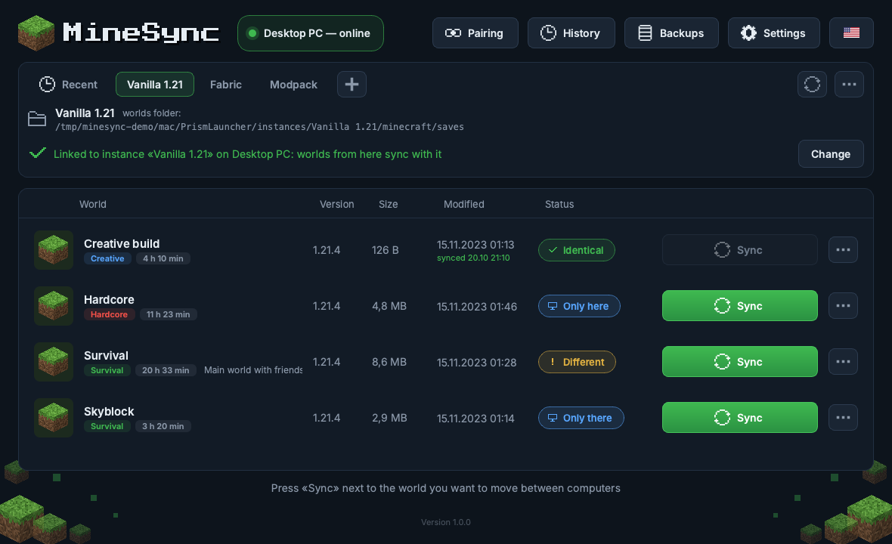
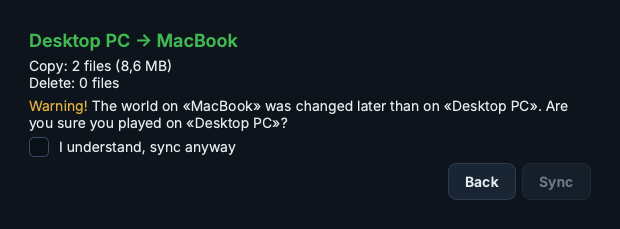

# MineSync

**English** · [Русский](README.ru.md)

Sync Minecraft Java Edition worlds between two computers on your home network:
Windows ↔ macOS, Windows ↔ Windows, macOS ↔ macOS.
You choose where you played last — the other computer becomes an exact copy of that world.

> MineSync is not affiliated with Mojang or Microsoft. License: MIT (see `LICENSE`).



## Features

- **One button per world** — green when the worlds differ, grey when they are identical or can't be synced.
- **Any launcher** — add an instance folder (Prism Launcher, MultiMC, CurseForge, the official launcher…) with «+»;
  the worlds folder inside is found automatically.
- **Instance links** — link an instance on this computer with one on the other computer once; both remember it.
- **Fast sync** — only new and changed files are transferred; unchanged files are never rewritten.
  Compressible data is sent compressed, and if Wi-Fi drops for a moment the transfer continues where it stopped.
- **Knows where you played** — after each sync MineSync remembers the state of the world, so next time it
  suggests the direction itself and warns you if the world was changed on both computers.
- **Backups** — before every sync the old versions of replaced files are kept, and «Restore» undoes a sync.
  An optional full-world backup mode is available in Settings.
- **Safe** — if the connection drops or the computer shuts down mid-sync, the world is rolled back to its previous state.
- **Warnings** — e.g. when the world on the receiving computer is newer, or when it is open in the game
  (syncing an open world is blocked). If the world changes on the other computer during a transfer, nothing is replaced.
- **Live status** — the list updates by itself after the game saves a world and when you enter or leave it.
- **Updates** — on startup MineSync checks GitHub for a new version and offers to download it
  (can be turned off in Settings).
- **Extras** — world descriptions, game mode / hardcore / play time badges, sync history, «Recent» tab,
  English and Russian interface.

## How to use

1. Run MineSync on both computers (they must be on the same home network).
2. **Pairing** (once): on one computer open «Pairing» → «Show code», on the other choose the computer
   and enter the 6 digits.
3. **Instances**: add an instance folder with «+». MineSync finds the worlds folder inside.
4. **Link instances** (once per instance): open the instance tab and choose which instance on the other
   computer to link it with.
5. **Sync**: press «Sync» next to a world and confirm where you played last (MineSync suggests the answer).



## Build the app (.exe / .app)

Build on each system separately (an `.exe` can only be built on Windows, an `.app` only on macOS).
In the project folder, after the development setup below:

```bash
# macOS — creates dist/MineSync.app
.venv/bin/python packaging/build.py

# Windows — creates dist\MineSync\MineSync.exe (keep the whole folder together)
.venv\Scripts\python packaging\build.py
```

On first launch allow MineSync to access the local network (macOS) and allow it in the firewall
for private networks (Windows), otherwise the computers won't find each other.

## Development

Python 3.12 or newer.

```bash
# macOS
python3 -m venv .venv
source .venv/bin/activate
pip install -e ".[dev]"

# Windows (PowerShell)
py -m venv .venv
.venv\Scripts\Activate.ps1
pip install -e ".[dev]"

python -m blocksync      # run from source
python -m pytest         # tests
ruff check src tests     # code style
mypy                     # types
```

The code and comments are in Russian; the interface is available in English and Russian
(`src/blocksync/resources/i18n`).

## Security

- Computers are paired once with a 6-digit code (valid for 2 minutes, 5 attempts).
  The code is never sent over the network — the SPAKE2 protocol is used.
- All traffic goes over HTTPS; device certificates are exchanged during pairing and pinned.
- Every request is also signed with the pair's shared key (HMAC-SHA256); requests from unpaired devices are rejected.
- Every transferred file is checked with SHA-256.
- The only connection outside your home network is the update check (a request to the GitHub API with the app version);
  it can be turned off in Settings.

## Known limitations

- Works within one local network. If you use a VPN, it must allow local network traffic («Bypass LAN»).
- Exactly two computers can be paired.
- Linux: the tests run on Linux, but the app itself hasn't been tried on a real Linux desktop.
- Undoing a sync with a «changes» backup restores only the files that sync touched; if you have played since,
  enable «Full world backup» in Settings.
- The game doesn't save mobs' head rotation, so after a sync (just like after rejoining a world) mobs face
  the direction of their body.
- The app is not signed with a developer certificate: a copy downloaded from the internet may need
  confirmation to open (macOS: right-click → Open; Windows: «More info» → «Run anyway»).

## Resources and licenses

- **Inter** font (all text) — © 2016 The Inter Project Authors, SIL Open Font License 1.1, `src/blocksync/resources/fonts/Inter-OFL.txt`.
- **Press Start 2P** font (logo, pairing code) — © 2012 The Press Start 2P Project Authors, SIL Open Font License 1.1, `src/blocksync/resources/fonts/PressStart2P-OFL.txt`.
- Block textures, icons and decorations are drawn by code (`src/blocksync/ui/pixel_art.py`, `ui/icons.py`, `ui/widgets.py`).
  No original Mojang/Minecraft textures, fonts, sounds or logos are used.

MineSync is an unofficial program and is not associated with Mojang or Microsoft. Minecraft is a trademark of Mojang Synergies AB.
