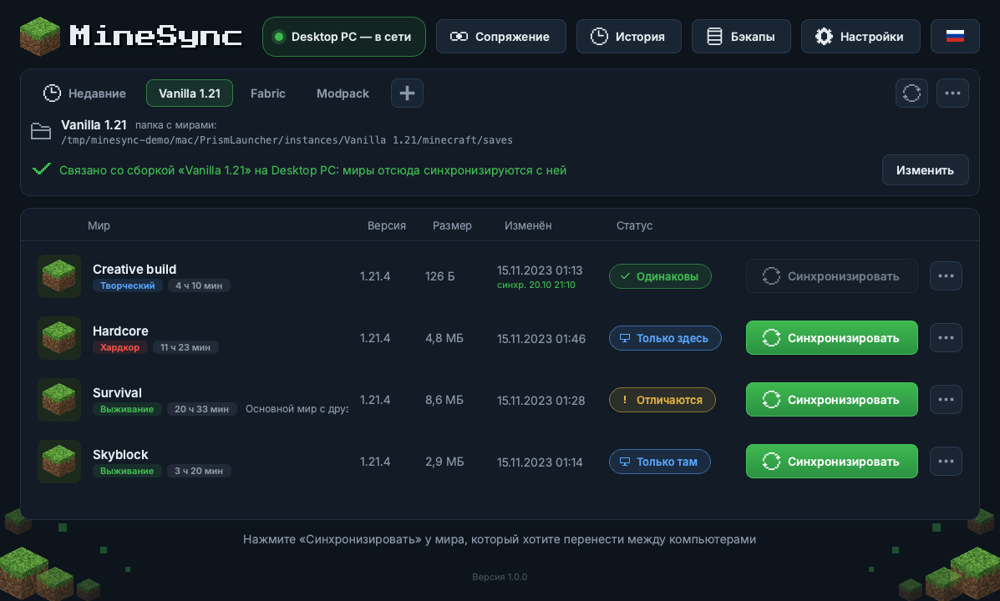
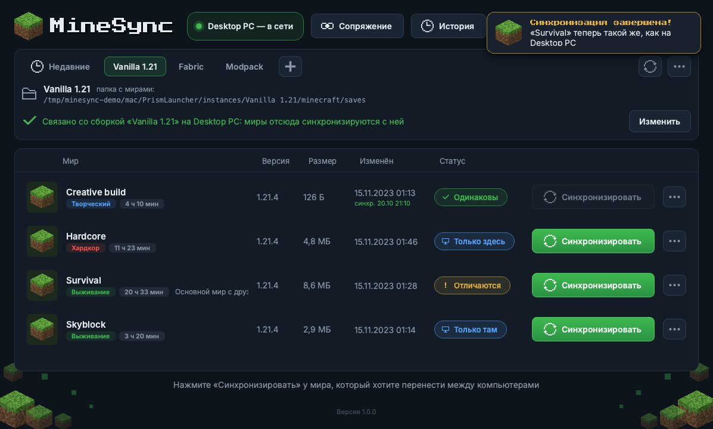

# MineSync

[English](README.md) · **Русский**

Синхронизация миров Minecraft Java Edition между двумя компьютерами по локальной сети:
Windows ↔ macOS, Windows ↔ Windows, macOS ↔ macOS.
Выбираешь, на каком устройстве играл последним, и второе устройство становится копией мира с него.

> MineSync не связан с Mojang и Microsoft. Лицензия — MIT (файл `LICENSE`).



## Как пользоваться

1. Запустите MineSync на обоих компьютерах (они должны быть в одной домашней сети).
2. **Сопряжение** (один раз): на одном компьютере «Сопряжение» → «Показать код»,
   на другом — выберите компьютер и введите 6 цифр.
3. **Сборки:** кнопкой «+» добавьте папку сборки (Prism Launcher, MultiMC, CurseForge,
   обычный лаунчер — любой). Папку с мирами программа найдёт внутри сама.
4. **Связь сборок** (один раз для каждой): откройте вкладку сборки и выберите, с какой
   сборкой на другом компьютере её связать. Второй компьютер запомнит связь сам.
5. **Синхронизация:** у мира с зелёной кнопкой нажмите «Синхронизировать» и ответьте,
   где играли последним. Второй компьютер станет копией. Перед заменой старые версии
   файлов сохраняются в бэкап («Бэкапы» → «Восстановить» откатывает синхронизацию).

Список миров обновляется сам: после сохранения мира в игре, при входе в мир и выходе из него.



## Сборка программы (.exe / .app)

Собирать нужно на каждой системе отдельно. В папке проекта, после установки для разработки:

```bash
# macOS — получится dist/MineSync.app
.venv/bin/python packaging/build.py

# Windows — получится папка dist\MineSync с MineSync.exe (переносить только всю папку)
.venv\Scripts\python packaging\build.py
```

При первом запуске разрешите MineSync доступ к локальной сети (macOS) и в брандмауэре
для частных сетей (Windows) — иначе компьютеры не найдут друг друга.

Перед тем как выкладывать сборку, можно проверить, что внутри нет личных слов
(имени, почты, путей к своим папкам):

```bash
.venv/bin/python packaging/check_bundle.py "Имя" "почта@example.com"
```

## Требования

- Python 3.12 или новее (проект разрабатывается на 3.13) — только для запуска из исходников и сборки

## Установка для разработки

macOS:

```bash
python3.13 -m venv .venv
source .venv/bin/activate
pip install -e ".[dev]"
```

Windows (PowerShell):

```powershell
py -3.13 -m venv .venv
.venv\Scripts\Activate.ps1
pip install -e ".[dev]"
```

## Запуск из исходников

```bash
python -m blocksync
```

## Тесты

```bash
python -m pytest
```

## Безопасность

- Устройства сопрягаются один раз по 6-значному коду (действует 2 минуты, 5 попыток).
  Код по сети не передаётся: используется протокол SPAKE2.
- Весь обмен идёт по HTTPS. Сертификаты устройств передаются при сопряжении и закрепляются,
  поэтому подслушать или подменить передаваемые миры в сети нельзя.
- Каждый запрос дополнительно подписывается общим ключом пары (HMAC-SHA256); запросы
  от несопряжённых устройств отклоняются.

## Известные ограничения

- Работает только в одной локальной сети. Если включён VPN, он должен пропускать
  трафик локальной сети (обычно это настройка «Обход локальной сети» / «Bypass LAN»).
- Одно сопряжённое устройство: синхронизируются ровно два компьютера.
- Linux: код для него есть, но на настоящем Linux программа не проверялась.
- Откат синхронизации «бэкапом изменений» возвращает только файлы, затронутые синхронизацией:
  если после неё уже играли, лучше включить в настройках «Полный бэкап мира».
- Поворот головы мобов игра не сохраняет, поэтому после переноса (как и после перезахода в мир)
  мобы смотрят по направлению тела.
- Программа не подписана сертификатом разработчика; собранная у себя — запускается без вопросов,
  скопированная с другого компьютера может потребовать подтверждения запуска.
- Сообщения о сетевых ошибках пока только на русском.

## Ресурсы и лицензии

- Шрифт **Inter** (весь текст) — © 2016 The Inter Project Authors, SIL Open Font License 1.1, `src/blocksync/resources/fonts/Inter-OFL.txt`.
- Шрифт **Press Start 2P** (логотип, код сопряжения) — © 2012 The Press Start 2P Project Authors, SIL Open Font License 1.1, `src/blocksync/resources/fonts/PressStart2P-OFL.txt`.
- Текстуры блоков (логотип, украшения, иконки миров без своей картинки, полоска прогресса) рисуются кодом в `src/blocksync/ui/pixel_art.py` и `ui/widgets.py`, значки — в `ui/icons.py`. Оригинальные текстуры, шрифты, звуки и логотипы Mojang/Minecraft не используются.

MineSync — неофициальная программа, не связанная с Mojang и Microsoft. Minecraft — товарный знак Mojang Synergies AB.
